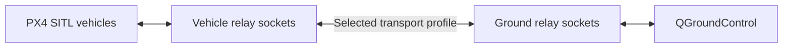

# Project0 · UAV Swarm Security Lab

**Compare MAVLink transport protection in reproducible PX4 and Gazebo experiments.**

[](https://github.com/Saikhaushik1138/Project0/actions/workflows/swarm-tests.yml)


[Setup](docs/setup.md) · [Architecture](docs/architecture.md) · [Research & evidence](docs/research.md) · [Validation](docs/validation.md) · [Documentation](docs/index.md)

Project0 studies confidentiality, authentication, and replay handling around UAV
telemetry. A unified launcher runs isolated PX4 software-in-the-loop vehicles,
connects them to QGroundControl, and records the selected security profile,
ports, processes, and results. Original research documents, measurements, and
experiments remain available alongside the maintained implementation.

## Capabilities

- **Three comparable profiles:** baseline MAVLink, HMAC-SHA256, and ChaCha20-Poly1305 through the same relay topology.
- **Multiple vehicles:** independent ports, per-vehicle credentials, and unique spawn positions for configurations of 1–64 vehicles.
- **Repeatable runs:** heartbeat-based readiness, isolated run directories, manifests, logs, and packet counters.
- **Analysis tools:** protocol benchmarks, Gazebo timing analysis, and process resource recording.
- **Traceable evidence:** original paper and slides, historical recordings, and retained simulation validation artifacts.

## Quick start: Python tools

Python 3.10 or later on Linux, macOS, or WSL is required. Run the following from
a terminal; PX4 and Gazebo are not needed for these tests or the dry-run plan.

```bash
git clone https://github.com/Saikhaushik1138/Project0.git
cd Project0
python3 -m venv .venv
source .venv/bin/activate
python -m pip install -e .

python -m unittest discover -s tests -v
python -m swarm_security launch --drones 4 --security chacha20 --dry-run
```

The editable installation also provides the `swarm-security` command. Keep
launch and diagnostic commands in the repository root so configuration,
simulator assets, and run paths are easy to locate.
Simulation launch and `doctor` require this editable checkout: the Python
distribution does not include PX4 source, submodules, or simulator assets.

## Run a simulation

Follow the [simulation setup guide](docs/setup.md) to initialize PX4 submodules,
install the platform dependencies, and build the local SITL executable. Then:

```bash
python -m swarm_security doctor
# First use only: creates private credentials and refuses to overwrite them.
python -m swarm_security keygen --drones 64
python -m swarm_security launch --drones 2 --security chacha20 \
  --keys config/keys.local.json
```

Open QGroundControl with automatic UDP connection on **14550**. The launcher
waits for vehicle heartbeats; it does not automatically arm or fly vehicles.
Use Ctrl+C to stop that run's processes, or add `--headless --duration 10` for a
short run without Gazebo's GUI. Reuse an existing key file for later runs.

Choose `--security baseline` for the unprotected comparison, or
`--security hmac --keys config/keys.local.json` for authentication without
payload encryption. Use `--startup-timeout 300` if a larger experiment needs
more initialization time. Configuring 64 vehicles does not establish that a
host can simulate 64 vehicles at a useful real-time factor.

## Transport architecture



The two relay sides run on the same host. They preserve complete MAVLink
datagrams, so the endpoints use ordinary MAVLink without parser changes.

| Profile | Payload encrypted | Message authentication | Replay checks |
| --- | --- | --- | --- |
| `baseline` | No | No added authentication | No |
| `hmac` | No | HMAC-SHA256 | Yes |
| `chacha20` | Yes | ChaCha20-Poly1305 | Yes |

**Research boundary:** protection applies between the relays. Local endpoint
traffic is plaintext, and direct access to raw PX4 ports can bypass the tunnel.
This is a trusted-host transport experiment with in-memory replay state.
The [architecture guide](docs/architecture.md) explains sessions, ports,
clock assumptions, and limits. It is not a deployment certification.

## Measure and inspect

```bash
# Protocol verification in memory; not a flight benchmark
python -m swarm_security benchmark --sizes 1 4 8 16 32 64 \
  --steps 100 --seed 7 --output runs/benchmark.json

# Analyze the retained Gazebo clock recording
python -m swarm_security analyze data/recordings/20260715_062734/gazebo_stats.log

# Explore individual commands
python -m swarm_security --help
python -m swarm_security launch --help
```

Simulation runs save manifests, process logs, heartbeat status, and packet
counters under the Git-ignored `runs/` directory. Run duration starts after
readiness. See [validation](docs/validation.md) for the recorded two- and
four-vehicle connectivity checks and the limits of those measurements. Larger
swarm configurations, physical flight, formation control, GPS anti-spoofing,
and X25519 exchange are not established by these checks.

## Repository map

| Location | Purpose |
| --- | --- |
| [`swarm_security/`](swarm_security/) | Maintained launcher, relay, crypto, benchmark, and analysis tools |
| [`tests/`](tests/) · [`scripts/`](scripts/) | Project tests and setup/verification helpers |
| [`docs/`](docs/index.md) · [`config/`](config/) | Guides, research mapping, and configuration notes |
| [`docs/references/`](docs/references/) | Original research paper and presentation |
| [`data/`](data/) | Historical measurements and retained validation evidence |
| [`archive/`](archive/) | Earlier implementations, automation definitions, and reorganization records |
| `src/`, `ROMFS/`, `Tools/`, `boards/`, `platforms/`, `cmake/` | PX4 source and build inputs in their expected locations |
| `build/` · `runs/` | Locally generated build products and experiment outputs; excluded from Git |

PX4 is based on upstream commit `99c40407ffd7ac184e2d7b4b293f36f10fe561ef` with
retained project changes. See [checkout notes](docs/github.md), the preserved
[PX4 README](docs/px4_upstream_readme.md), and the [BSD 3-Clause license](LICENSE).
For changes or reports, read [Contributing](CONTRIBUTING.md) and
[Security](SECURITY.md).
