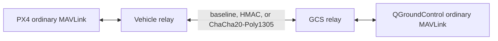

# MAVLink transport and experiment boundaries

The launcher starts one Gazebo world and N PX4 instances. Instance `i` gets
MAVLink system ID `i+1`, its own working directory and log, and a unique grid
position. The run has a separate Gazebo discovery partition. Only processes
started by that run are stopped during cleanup.

For each run, the launcher copies generated PX4 resources into a temporary
`runs/<run>/etc` tree and replaces its MAVLink startup script. That script
starts one GCS link pointed at the relay and omits the ordinary offboard,
camera, and gimbal links. This also avoids overlapping default port ranges in
large swarms. The original source ROMFS and build outputs remain unchanged.

## One vehicle's path

Both relay sides run inside one local process, with distinct sockets and
independent encode/decode contexts. This models the transport boundary without
modifying the PX4 or QGroundControl MAVLink parsers. It is not a distributed
radio deployment.

| Endpoint | UDP port for instance i | Use |
| --- | --- | --- |
| PX4 GCS socket | `18570+i` | Sends plaintext telemetry and receives restored commands |
| Vehicle plaintext relay | `20000+i` | Receives PX4 telemetry and sends commands back |
| GCS plaintext relay | `21000+i` | Sends telemetry to QGC and receives its commands |
| Vehicle transport socket | `22000+i` | Protected command reception and telemetry transmission |
| GCS transport socket | `23000+i` | Protected telemetry reception and command transmission |
| QGroundControl | `14550` | Shared standard GCS endpoint for all vehicles |

All relay sockets bind to localhost. Routing checks exact configured source
addresses and ports; incoming traffic cannot change a route. MAVLink system IDs
remain the responsibility of PX4 and QGroundControl. The relay forwards complete
datagrams, including checksums, signed frames, and multiple frames in a packet.
It observes valid vehicle heartbeats after the transport receiver accepts them.

PX4's standard simulation GCS port is 14550 and offboard ports follow their own
mapping in [PX4's simulation documentation](https://docs.px4.io/v1.15/en/simulation/).
This project's additional port ranges belong to the proxy experiment only.

## Envelope

Protected modes authenticate the protocol version, mode, direction, drone ID,
128-bit random sender session, 64-bit packet counter, timestamp, and payload.
HKDF derives a separate key for each drone, session, direction, and mode.
ChaCha20-Poly1305 uses the counter as the unique nonce within a session.
HMAC-SHA256 leaves the datagram readable and authenticates it.

The receiver verifies authentication before adding replay state. It keeps a
256-packet reordering window per session, expires stale sessions, and fails
closed when its bounded session capacity is exhausted. A 30-second freshness
window and rejection of timestamps predating receiver startup provide local
restart protection. This assumes the shared host clock; no cross-host clock
synchronization or handshake is implemented. Replay state is held in memory.

These envelopes are a custom transport protocol. They are distinct from
[native MAVLink 2 message signing](https://mavlink.io/en/guide/message_signing.html),
which authenticates MAVLink messages but does not encrypt their contents.

## Trust boundary

The experiment protects the link between the two relays. QGC-to-relay and
relay-to-PX4 legs are plaintext, and the local machine and its processes are
trusted. PX4's stock UDP implementation can listen on wildcard addresses even
when its configured peer is localhost. Setting a localhost peer does not create
a host firewall. A host or LAN attacker reaching a raw PX4 port can bypass this
research tunnel. Do not claim end-to-end aircraft protection from this setup.

The test harness sends harmless heartbeats and protocol probes. It does not
demonstrate physical anti-jamming, GPS sensor authenticity, behavior-based
intrusion detection, credential revocation, or resistance after a key/host
compromise. A transport rate cap bounds some receiver work but is not proof of
DoS resistance. No formation planning or automatic arm/takeoff is included.

## Measurements

Run manifests preserve the profile, count, poses, ports, process IDs, and
startup/completion status. Relay counters report input/delivery packets, bytes,
reject reasons, and aggregate elapsed handler time. Handler time includes socket
and status-file work; it is neither CPU time nor end-to-end radio latency.
Process sampling reports CPU and RSS.

`benchmark` independently exercises the verifier in memory and reports its
observed outcomes. `analyze` calculates Gazebo real-time factor and physics
update rate from recorded clock fields. Physics update rate is not GUI frame
rate. Historical measurements remain separate under `data/`.
